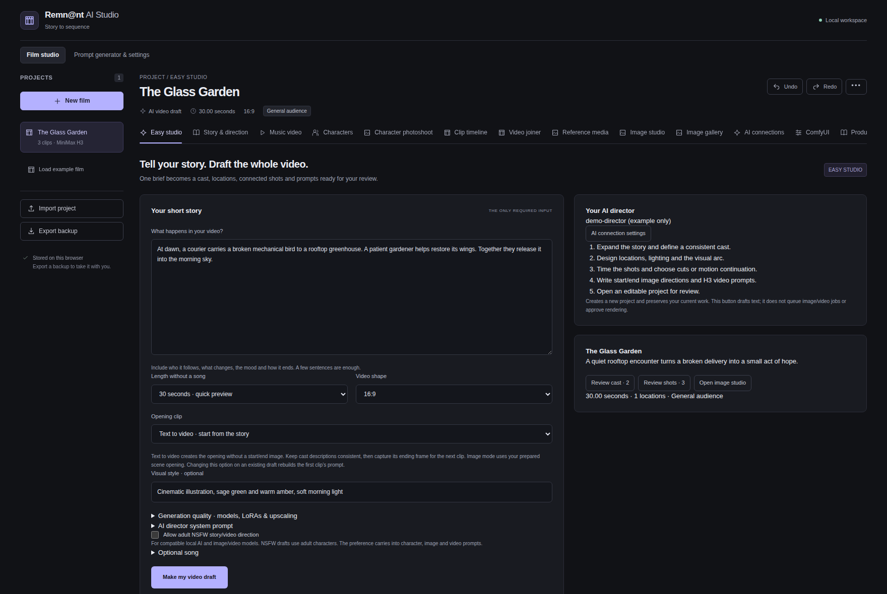
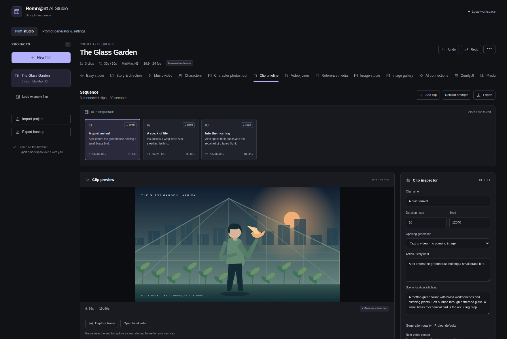
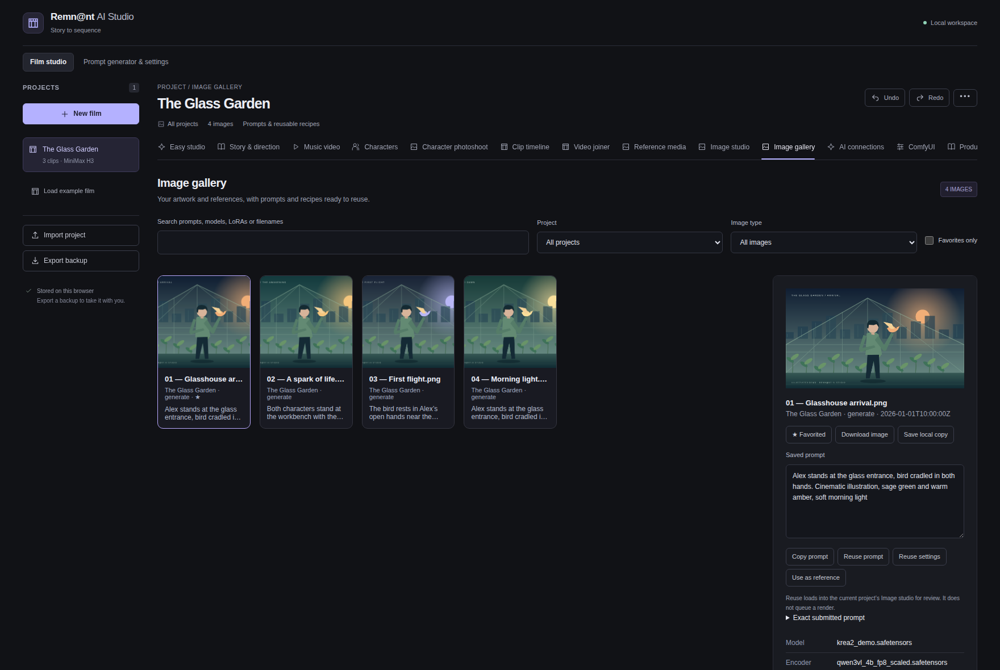
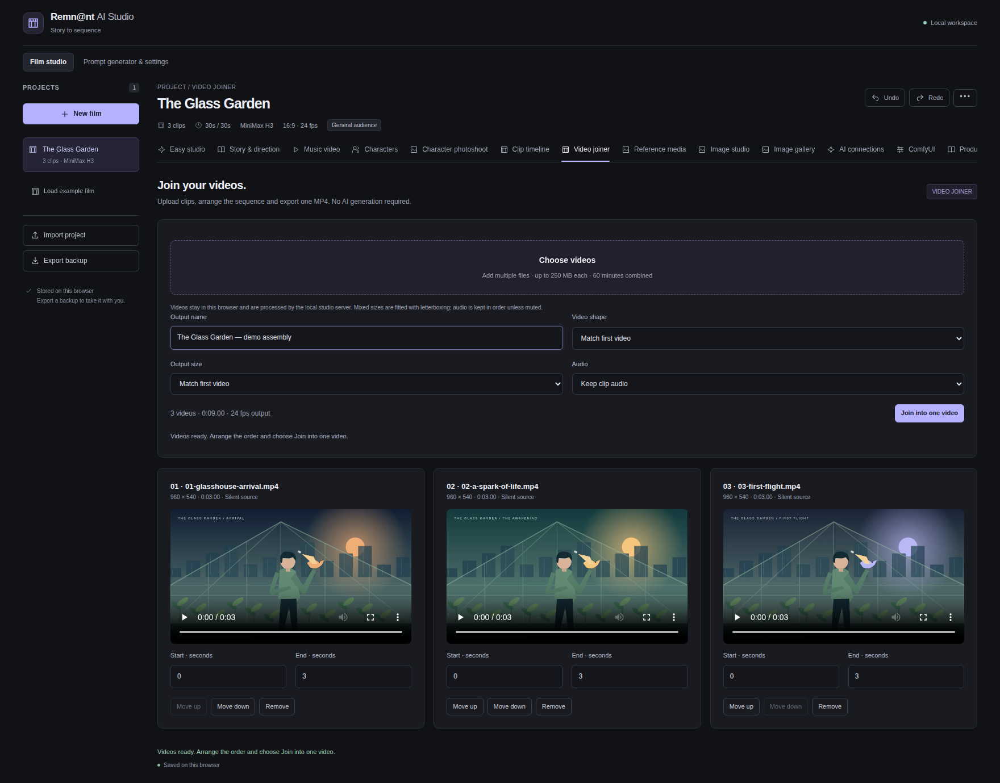

# Remn@nt AI Studio

A local creative workspace for turning a story or song into a reviewable film plan, directing ComfyUI image/video workflows, and joining finished clips into one MP4.



## What you can do

- **Easy Studio:** write a short story, optionally add a song, and let your connected AI draft editable characters, locations, shot directions and video prompts. Review before rendering.
- **Connected video:** open with text-to-video, then use the actual last rendered frame to guide the next clip. Change to a cut when the location or action needs a new setup. Finish the sequence as one MP4.
- **Music videos:** plan shots against song timing and use your original master as the final soundtrack.
- **Image Studio:** generate, edit and upscale Krea images; prepare scene start/end images; save images and prompt metadata to a searchable library.
- **Characters:** maintain canonical references, wardrobe and approved views. Optional character/photoshoot workflow wrappers require separately obtained workflow files.
- **Quality controls:** choose compatible diffusion models, LoRAs and upscalers at project or clip level. The optional “DLSS 5 / OreX” adapter requires its matching backend custom node; it is not bundled NVIDIA software or a compatibility guarantee.
- **Video joiner:** upload videos, reorder and trim them, fit mixed resolutions, keep or mute audio, then download one MP4. No AI server is needed for joining.
- **Local AI connections:** connect an OpenAI-compatible API on this computer or a private LAN, including vLLM, LM Studio, Ollama or a compatible Unsloth deployment.
- Project-scoped director instructions and an optional adult-content preference are available for compatible local backends. The default is general audience. Backend capabilities and policies apply.



## Run locally

Requires **Python 3.10+**, **FFmpeg with ffprobe and libx264**, and a modern browser. Python uses only the standard library. Node.js is needed for development/tests, not to run the app.

```bash
python3 studio-server.py --port 8099 --comfy-url http://127.0.0.1:8188
```

Open **http://127.0.0.1:8099/**. The app works through this server; opening `index.html` directly omits the API relay and finishing tools.

1. In **ComfyUI**, save your renderer address and test the connection. ComfyUI, custom nodes and model weights must be installed separately on your GPU machine.
2. In **AI connections**, set your API base (for example `http://127.0.0.1:8000/v1`), discover/select a model and test it. Optional API keys stay in the current browser session.
3. In **Easy studio**, enter a story and make a draft. Review the cast, scene states, prompts, generation settings and transitions.
4. Select a compatible workflow and required references. Approve and render the sequence; download the finished video.

The included H3/Krea graphs use specific node interfaces and model families. This project does not download models, install custom nodes or provide a hosted generation API. Use **Refresh models** to validate against your own backend. See [workflow setup and separate rights](workflows/README.md).

## Screenshots

Screenshots show the real UI with a fictional demo project, programmatic illustrative media and mocked generation results. They do not show a private production or claim to benchmark a GPU.

| Image library | Video joining |
| --- | --- |
|  |  |

## Where your data goes

Project metadata lives in browser localStorage; local media lives in IndexedDB. Workspaces are specific to the browser and origin (host, scheme and port). Use **Export backup** before moving to a different address, clearing browser data or upgrading.

Selected prompts/media are sent to the ComfyUI or AI endpoint you configure. Temporary finishing files are stored outside the web root and normally disappear when the server exits. **Download finished movies before restarting.** Saved ComfyUI connection settings live outside the source tree; use `--settings-file` to choose a location. A previously saved address takes precedence over the initial `--comfy-url` value.

Backups can include private prompts, media, endpoint addresses and imported workflow contents. Review them before sharing. Never put credentials in workflow JSON or project prompts. Keep API keys in the dedicated session-only connection field.

## Deployment and security

This is a **single-user local / trusted-LAN application**, with no built-in account system or per-user isolation. Do not expose it directly to the internet. A public GitHub repository does not make the running studio a public service. Protect remote access with an authenticated HTTPS gateway or VPN and restrict access to the backend AI services.

For a dedicated unprivileged Proxmox LXC, see [the installation guide](deploy/PROXMOX_LXC.md). Read [SECURITY.md](SECURITY.md) for the threat model and reporting guidance.

## Development

```bash
npm test
python3 -m unittest discover -s tests -p '*_test.py'
python3 tools/check-release.py
```

Unit tests need Node.js 22+; Python integration tests need FFmpeg and run only against isolated local services. Browser tests require Playwright/Chromium and a fresh test server; see [CONTRIBUTING.md](CONTRIBUTING.md). Tests use synthetic node contracts and mock AI/GPU jobs. They do not verify every custom-node version or visual output quality.

## License and credits

Original application code is available under the [MIT License](LICENSE): use, modify and distribute it, including commercially, while retaining the license notice. **Workflow, model, custom-node and media rights are separate**; see [THIRD_PARTY_NOTICES.md](THIRD_PARTY_NOTICES.md). No model weights or unverified third-party workflow downloads are redistributed in this release.

Independent project; not affiliated with ComfyUI, MiniMax, Krea or NVIDIA. See the [release checklist](docs/RELEASE_CHECKLIST.md) and [review findings](docs/CODE_REVIEW.md) before publishing a modified copy.
